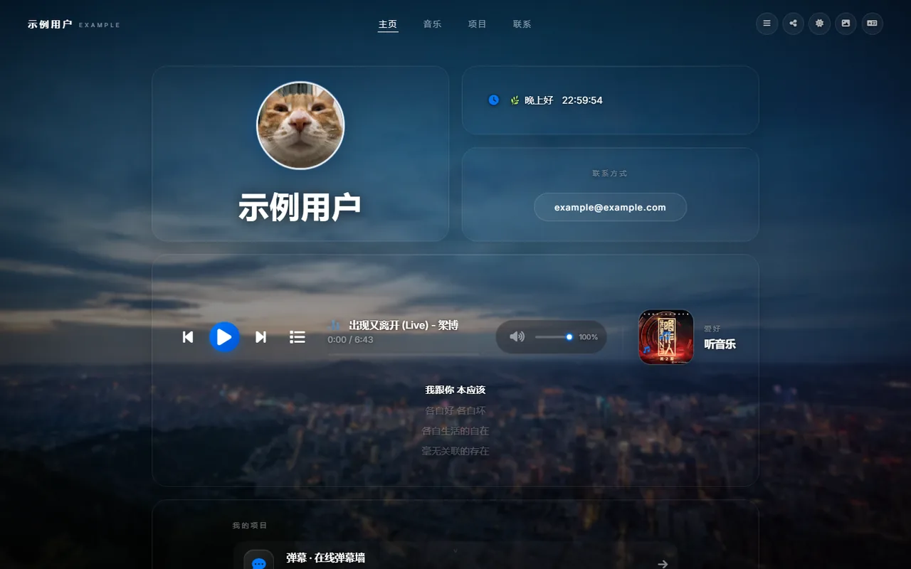
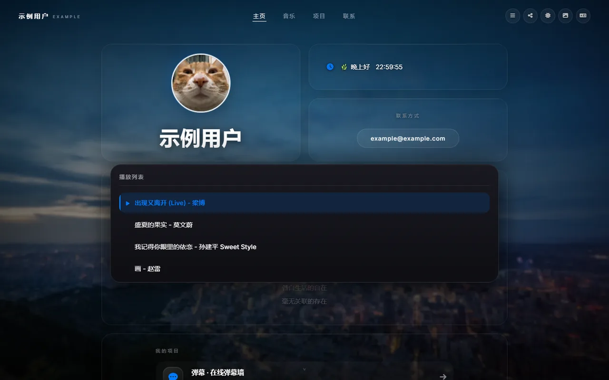
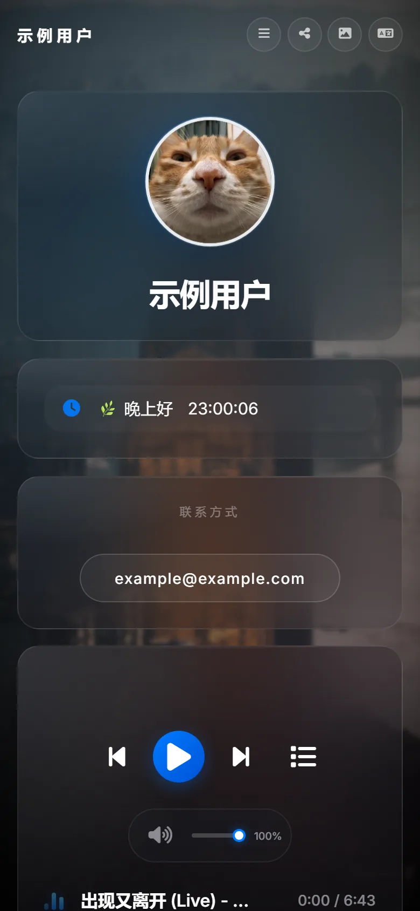

# 雨天 · 动态交互式个人主页

> 一个**纯前端、零依赖**的个人主页：Bento Grid 布局 + Liquid Glass 视觉，外加一个能直接读 FLAC / ID3 标签（内嵌封面 + LRC 歌词）的在线音乐播放器。

<p>
  <a href="https://www.yutian.me"></a>
  
  
  <a href="#版权与许可"></a>
</p>



## ✨ 为什么值得一看

大多数「个人主页模板」是几段 CSS 动画拼起来的。这个项目里真正花时间的是**播放器**：它不引任何音频库，自己解析 FLAC 的元数据块和 MP3 的 ID3v2 标签，把内嵌的专辑封面和 LRC 歌词读出来——封面用 canvas 缩到 256px 再显示，歌词按时间轴滚动、逐字点亮。整套逻辑 1000 多行原生 JS，打开就是能用的静态页面。

## 🎯 功能

**音乐播放器**

- 🎼 **手写 FLAC / ID3v2 解析** — 读内嵌封面（`PICTURE` / `APIC`）与歌词（`LYRICS` / `USLT` / `TXXX`），零依赖
- 📝 **歌词面板** — 按时间滚动居中、当前行高亮、逐字「卡拉 OK」点亮；自动过滤作词/作曲/编曲等制作名单
- 📊 **实时频谱** — Web Audio `AnalyserNode` + canvas，播放时才跳动
- 🎚️ **完整播放控制** — 播放/暂停、上下曲、拖动进度、音量、播放列表；点歌即播并收起列表
- 🎧 **系统媒体控制** — MediaSession 元数据，锁屏 / 蓝牙耳机可显示曲名封面
- 💾 **克制的记忆** — 只记「上次听到第几首」和音量，**不记播放进度**（避免恢复时跳时间、卡住）

**界面**

- 🧊 **Liquid Glass + Bento Grid** — 毛玻璃卡片、发丝描边、鼠标高光跟随
- 🖼️ **静态壁纸** — 横屏 / 竖屏各两张，按屏幕朝向自动切换，可一键换图并记住选择
- 🌗 **深浅主题** — 首帧前应用，避免闪白（FOUC）；跟随系统偏好
- 🌍 **四语言** — 简体中文 / 繁體中文 / 日本語 / English，切换后记住
- 🕒 **本地化信息条** — 时间问候 + 免密钥天气（ipwho.is + Open-Meteo）
- 📱 **响应式** — 桌面四列、平板两列、手机单列；手机上导航收进全屏菜单
- ⌨️ **键盘友好** — `空格` 播放/暂停、`←/→` 切歌、`Esc` 关闭浮层

**工程**

- 🔍 **SEO** — canonical、OG / Twitter 卡片、JSON-LD（ProfilePage + Person）、`robots.txt`、`sitemap.xml`
- ⚡ **无构建** — 三个文件 + 几张图，扔到任何静态托管就能跑
- 🛡️ **渐进增强** — 无 JS 时用 `<noscript>` 兜底，不会白屏

## 📷 截图

| 主页 | 播放列表 |
|---|---|
|  |  |

| 移动端（竖屏壁纸） |
|---|
|  |

## 🛠️ 技术说明

| 部分 | 实现 |
|---|---|
| 布局 | CSS Grid（4 列 bento）+ 媒体查询降级 |
| 玻璃质感 | `backdrop-filter` + 多层渐变 + 1px 内高光；不支持时降级为不透明底 |
| 壁纸 | CSS `background-image` + `@media (orientation: portrait)`，JS 只负责换图与记忆 |
| 标签解析 | `DataView` 手写 FLAC 元数据块链 / ID3v2.3–2.4 帧解析，`fetch` + `Range` 只取文件头 |
| 封面 | `createImageBitmap` → canvas 缩放到 256×256 → JPEG data URL |
| 歌词 | 自写 LRC 解析（支持一行多时间戳），`requestAnimationFrame` 内做逐字插值 |
| 频谱 | `createMediaElementSource` + `AnalyserNode`，仅在 `play` 时启动 rAF |
| 主题 | 首帧内联脚本读 `localStorage` / `prefers-color-scheme`，避免 FOUC |

## 📂 目录结构

```
├── index.html            # 页面结构 + 元信息 + 关键内联样式
├── style.css             # 样式（Bento / Liquid Glass / 主题变量 / 响应式）
├── script.js             # 交互（播放器、解析、主题、i18n、壁纸、滚动）
├── wall-land-1.webp      # 横屏壁纸 1（1920w）
├── wall-land-2.webp      # 横屏壁纸 2
├── wall-port-1.webp      # 竖屏壁纸 1（1280w）
├── wall-port-2.webp      # 竖屏壁纸 2
├── touxiang.PNG          # 头像
├── favicon.png           # 站点图标
├── robots.txt            # 爬虫协议
├── sitemap.xml           # 站点地图
├── screenshots/          # README 截图
└── .gitignore
```

> 音乐（`.mp3` / `.flac`）与视频（`.mp4`）**不入库**：一首无损动辄 20–30MB，且涉及版权。仓库里只保留代码，想听歌请自己放文件（见下一节）。

## 🚀 本地运行

必须用 **HTTP 服务**打开，不能双击 `index.html`——`fetch` 读音频元数据在 `file://` 下会被浏览器拦截。

```bash
python -m http.server 8000
# 或 npx serve .
# 然后访问 http://localhost:8000
```

把音频放进根目录，并在 `script.js` 顶部的 `playlist` 里登记：

```js
playlist: [
  { src: '你的歌.mp3', title: '曲名 - 歌手' },
]
```

封面和歌词不需要额外配置：写进音频文件的标签（FLAC 的 VORBIS_COMMENT / PICTURE，MP3 的 ID3v2 USLT / APIC）就会自动读出来。

## ☁️ 部署

**Cloudflare Pages**（本站用的方案）：仓库连到 Pages，构建命令留空，输出目录填 `/`，推送到 `main` 即自动发布，自带全球 CDN 和免费 HTTPS。

**GitHub Pages**：Settings → Pages → Source 选 `main` / root，一分钟就能得到一个 `https://<用户名>.github.io/myhome/` 的预览地址。

**任意静态托管**：Vercel、Netlify、对象存储都行，没有服务端依赖。

## 🎨 改成你自己的

| 想改什么 | 改哪里 |
|---|---|
| 名字 / 邮箱 / 项目链接 | `index.html` 里对应文本，和 `script.js` 里 `initLanguage()` 的 `translations` |
| 主色 | `style.css` 的 `--accent`、`--accent-glow` |
| 壁纸 | 替换 `wall-land-*.webp` / `wall-port-*.webp`（保持同名即可，横 1920w、竖 1280w 比较合适） |
| 头像 / 图标 | `touxiang.PNG`、`favicon.png` |
| 歌单 | `script.js` 顶部 `playlist` 数组，音频文件放根目录 |
| 站点域名 | `index.html` 里所有 `https://www.yutian.me` 与 `sitemap.xml`、`robots.txt` |

## ❓ 常见问题

**Q：为什么播放器显示「音乐加载失败」？**
仓库里没有音频文件。把 `.mp3` / `.flac` 放进根目录，并在 `playlist` 里写对文件名即可。

**Q：为什么封面 / 歌词是空的？**
两种情况：音频本身没写标签（可以用 Mp3tag、foobar2000 补），或者你是用 `file://` 直接打开的（见「本地运行」）。

**Q：为什么刷新后歌曲不是从刚才的位置继续？**
这是刻意的。播放进度记忆恢复时容易跳时间、卡在缓冲，所以只记「第几首」和音量。

**Q：能直接拿去当自己的主页吗？**
可以看、可以学、可以按 README 改，但**公开发布前请先看下面的许可条款**。

## 📝 更新日志

**2026-10（v2）**

- 动态视频壁纸 → 静态双图壁纸（横/竖各两张，按朝向切换）
- 顶栏重做：字标 + 发丝下划线导航 + 圆形工具钮，滚动收起
- 播放器修复：卡片 3D 倾斜导致播放列表点不中、点歌不关闭列表、封面悬浮抖动
- 去掉播放进度记忆，只保留曲目与音量
- 首屏体积约 250KB（壁纸 150KB + 代码 45KB + 图标字体）

**更早**：Bento Grid + Liquid Glass 初版、四语言、歌词逐字点亮、MediaSession。

## 📄 版权与许可

本项目为 **雨天 (yutian.me)** 的个人原创作品，**保留所有权利 (All Rights Reserved)**。未经授权，任何人不得：

- ⛔ **商用** — 不得将本站源码、文字、图片或设计用于任何商业用途或盈利目的。
- ⛔ **二次修改 / 衍生** — 不得对源码进行改编、重制、再创作并公开发布（禁止衍生作品）。
- ⛔ **移除署名** — 转载、引用、分享时必须保留作者署名「雨天」及原始出处 <https://github.com/xsfnb/myhome>。

**允许**：个人学习与浏览；在完整保留版权声明与出处链接的前提下分享页面链接；通过 Issue / PR 提出改进建议。

**需要商用、二创或改编**：请先通过 [Issue](https://github.com/xsfnb/myhome/issues) 联系作者取得书面授权。未经许可使用，作者保留追究责任的权利。

> 本声明对页面全部内容（代码、文字、图像与设计）均生效。

## ⭐ Star History

如果这个项目对你有帮助，点个 Star 是对作者最大的鼓励。

[](https://star-history.com/#xsfnb/myhome&Date)

---

<details>
<summary>English</summary>

A dependency-free personal homepage: CSS Grid bento layout, liquid-glass surfaces, light/dark themes, four languages, and a hand-written music player that parses FLAC metadata blocks and MP3 ID3v2 tags (embedded cover art + LRC lyrics) without any library. No build step — three files and a few images.

Demo: <https://www.yutian.me> · License: All Rights Reserved (see above).

</details>
